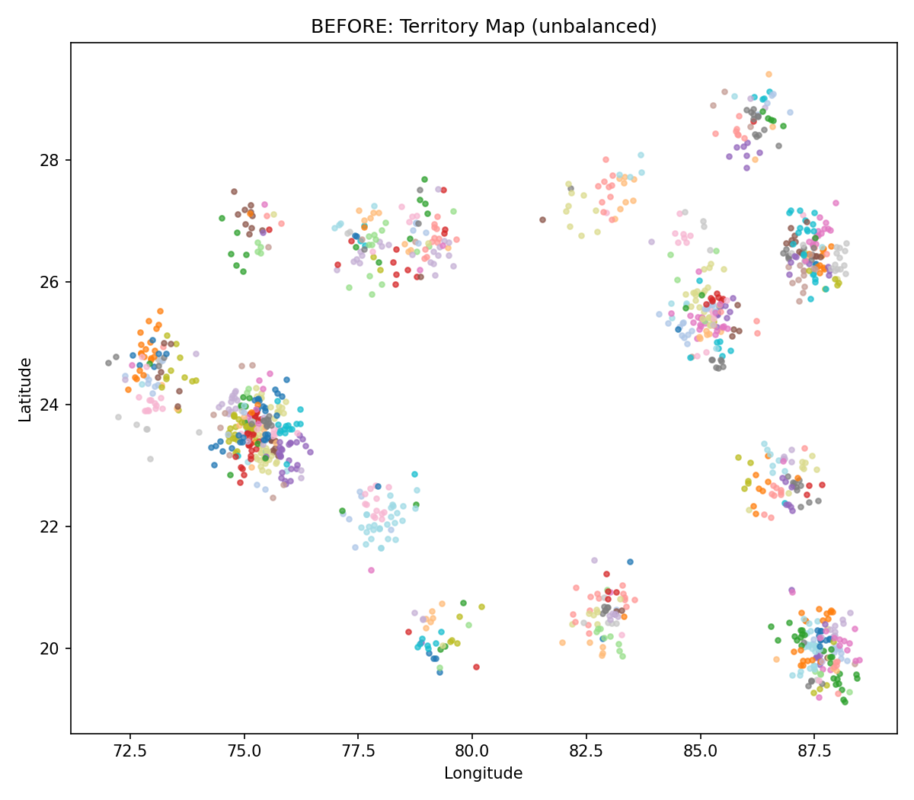
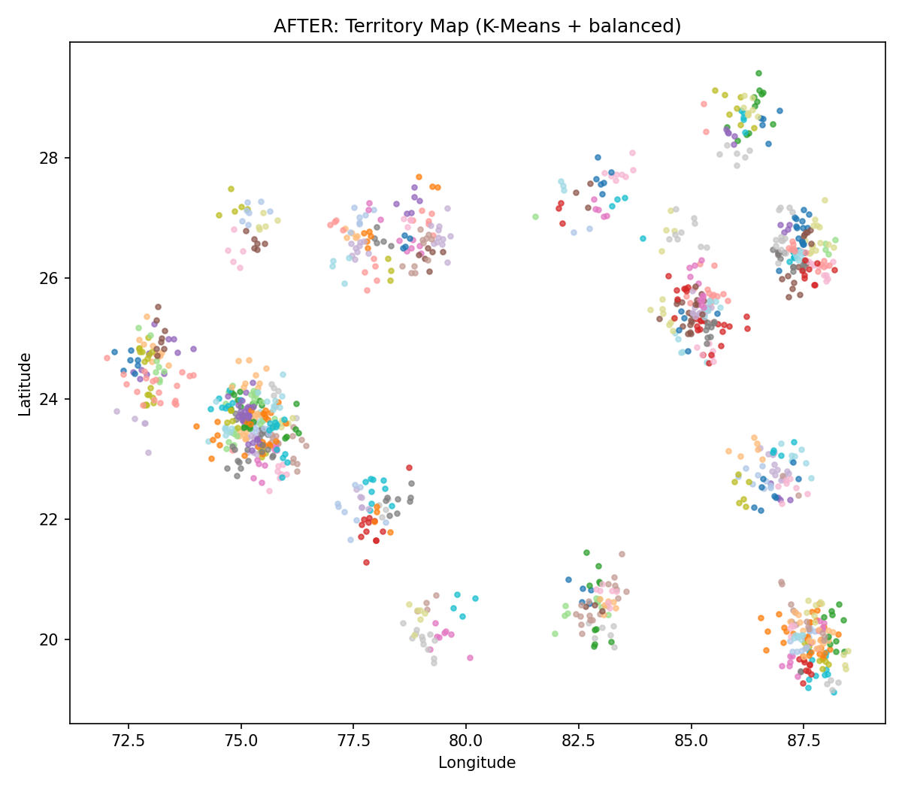
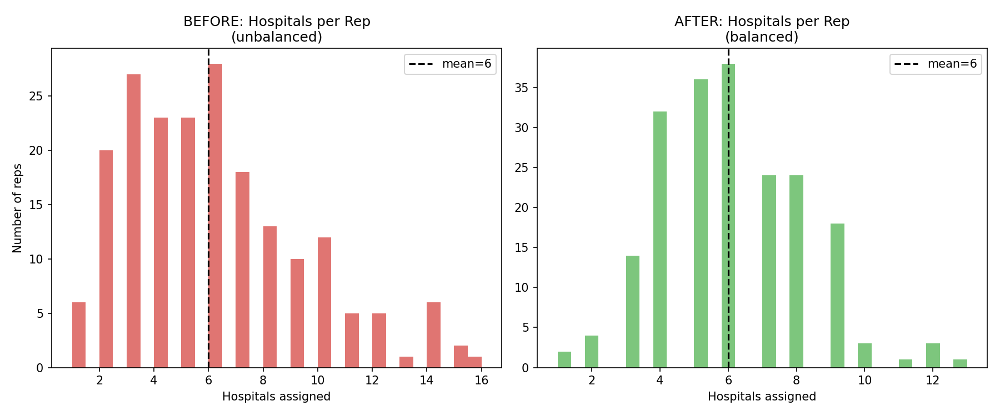
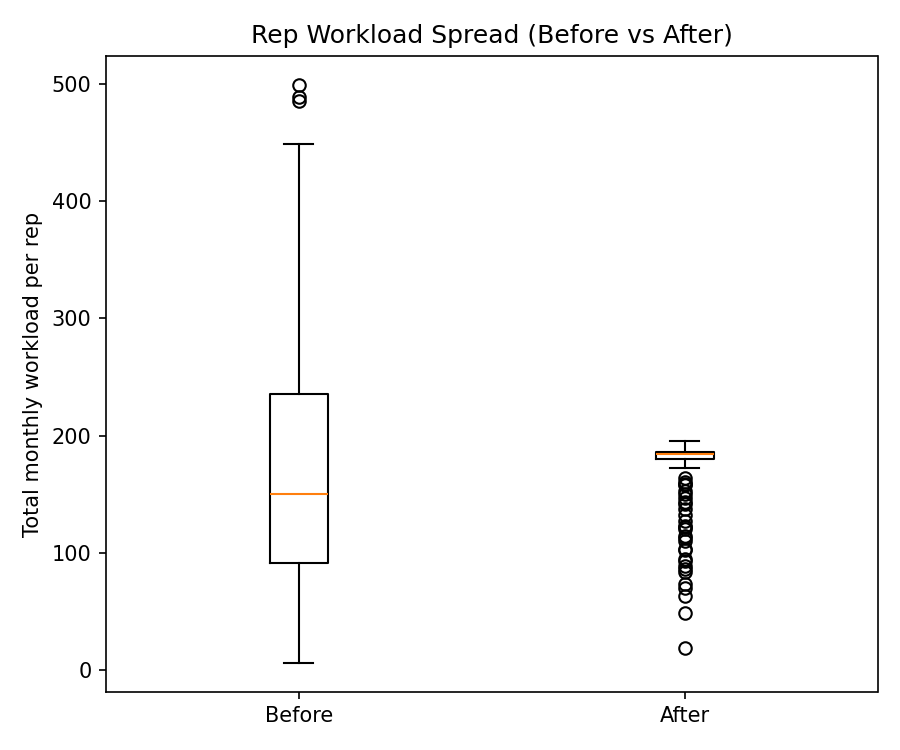

# SQL Analysis (PostgreSQL)

Before applying the territory optimization algorithm, the hospital dataset was explored using PostgreSQL to understand workload distribution, hospital types, and city-wise patterns. These SQL queries demonstrate data analysis skills ranging from beginner to advanced.

---

## 0. Create Table

```sql
CREATE TABLE hospitals (
    hospital_id VARCHAR(20) PRIMARY KEY,
    latitude DECIMAL(10,6),
    longitude DECIMAL(10,6),
    city_cluster VARCHAR(50),
    hospital_type VARCHAR(50),
    monthly_workload INT
);
```

---

# Beginner Queries

## 1. View all records
```sql
SELECT * FROM hospitals;
```

## 2. Count total hospitals
```sql
SELECT COUNT(*) AS total_hospitals FROM hospitals;
```

## 3. List hospital types
```sql
SELECT DISTINCT hospital_type FROM hospitals;
```

## 4. Count hospitals by type
```sql
SELECT hospital_type, COUNT(*) total_hospitals
FROM hospitals
GROUP BY hospital_type
ORDER BY total_hospitals DESC;
```

## 5. Average monthly workload
```sql
SELECT ROUND(AVG(monthly_workload),2) avg_workload
FROM hospitals;
```

## 6. Top 10 busiest hospitals
```sql
SELECT hospital_id,hospital_type,monthly_workload
FROM hospitals
ORDER BY monthly_workload DESC
LIMIT 10;
```

# Intermediate Queries

## 7. Average workload by hospital type
```sql
SELECT hospital_type, ROUND(AVG(monthly_workload),2) avg_workload
FROM hospitals
GROUP BY hospital_type
ORDER BY avg_workload DESC;
```

## 8. Total workload by hospital type
```sql
SELECT hospital_type,SUM(monthly_workload) total_workload
FROM hospitals
GROUP BY hospital_type
ORDER BY total_workload DESC;
```

## 9. Hospitals in each city
```sql
SELECT city_cluster,COUNT(*) hospitals
FROM hospitals
GROUP BY city_cluster
ORDER BY hospitals DESC;
```

## 10. Total workload by city
```sql
SELECT city_cluster,SUM(monthly_workload) total_workload
FROM hospitals
GROUP BY city_cluster
ORDER BY total_workload DESC;
```

## 11. Average workload by city
```sql
SELECT city_cluster,ROUND(AVG(monthly_workload),2) avg_workload
FROM hospitals
GROUP BY city_cluster
ORDER BY avg_workload DESC;
```

## 12. Hospitals above overall average workload
```sql
SELECT hospital_id,hospital_type,monthly_workload
FROM hospitals
WHERE monthly_workload>(
SELECT AVG(monthly_workload) FROM hospitals)
ORDER BY monthly_workload DESC;
```

# Advanced Queries

## 13. Rank hospitals by workload
```sql
SELECT hospital_id,hospital_type,monthly_workload,
RANK() OVER(ORDER BY monthly_workload DESC) workload_rank
FROM hospitals;
```

## 14. Top 3 busiest hospitals in every city
```sql
SELECT *
FROM(
SELECT *,
ROW_NUMBER() OVER(PARTITION BY city_cluster
ORDER BY monthly_workload DESC) rn
FROM hospitals
)t
WHERE rn<=3;
```

## 15. Percentage contribution of each hospital type
```sql
SELECT hospital_type,
SUM(monthly_workload) workload,
ROUND(
100.0*SUM(monthly_workload)/
SUM(SUM(monthly_workload)) OVER(),2
) workload_percentage
FROM hospitals
GROUP BY hospital_type
ORDER BY workload_percentage DESC;
```

## 16. Categorize hospitals by workload
```sql
SELECT hospital_id,
monthly_workload,
CASE
WHEN monthly_workload>=60 THEN 'High'
WHEN monthly_workload>=30 THEN 'Medium'
ELSE 'Low'
END workload_category
FROM hospitals;
```

## 17. Running workload within each city
```sql
SELECT city_cluster,
hospital_id,
monthly_workload,
SUM(monthly_workload)
OVER(PARTITION BY city_cluster
ORDER BY monthly_workload DESC)
AS cumulative_workload
FROM hospitals;
```

## 18. Compare each hospital with city average
```sql
SELECT hospital_id,
city_cluster,
monthly_workload,
ROUND(AVG(monthly_workload)
OVER(PARTITION BY city_cluster),2)
AS city_average,
monthly_workload-
AVG(monthly_workload)
OVER(PARTITION BY city_cluster)
AS difference
FROM hospitals;
```

## 19. Divide hospitals into workload quartiles
```sql
SELECT hospital_id,
monthly_workload,
NTILE(4)
OVER(ORDER BY monthly_workload DESC)
AS workload_quartile
FROM hospitals;
```

## 20. Cities above overall average workload
```sql
SELECT city_cluster,
ROUND(AVG(monthly_workload),2) avg_workload
FROM hospitals
GROUP BY city_cluster
HAVING AVG(monthly_workload)>
(SELECT AVG(monthly_workload) FROM hospitals)
ORDER BY avg_workload DESC;
```

# Conclusion

These SQL analyses were performed before the optimization stage to understand the distribution of hospitals, workload imbalance, and geographic patterns. The insights obtained through SQL complemented the Python-based territory optimization pipeline by validating the dataset and identifying workload characteristics prior to clustering and capacity-constrained optimization.

### Top 10 Most Improved Representatives

```sql
SELECT
b.rep_id,
b.total_workload before_workload,
a.total_workload after_workload,
b.total_workload-a.total_workload workload_reduction
FROM before_summary_by_rep b
JOIN after_summary_by_rep a
ON b.rep_id=a.rep_id
ORDER BY workload_reduction DESC
LIMIT 10;
```

---

### Travel Distance Reduction

```sql
SELECT
ROUND(AVG(b.avg_distance_km),2) before_distance,
ROUND(AVG(a.avg_distance_km),2) after_distance
FROM before_summary_by_rep b
JOIN after_summary_by_rep a
ON b.rep_id=a.rep_id;
```

---

### Representatives Whose Workload Increased

```sql
SELECT
rep_id,
before_workload,
after_workload
FROM
(
SELECT
b.rep_id,
b.total_workload before_workload,
a.total_workload after_workload
FROM before_summary_by_rep b
JOIN after_summary_by_rep a
ON b.rep_id=a.rep_id
)t
WHERE after_workload>before_workload;
```

---

# Sales Territory Optimization

Balance a 200-rep sales force so no rep is overloaded and no rep is
underutilized, using geospatial clustering and capacity-constrained
optimization. Built as a portfolio project targeting **ZS Associates** and
similar analytics-consulting roles (pharma/med-tech commercial analytics is
ZS's core business, and this exact problem — "call panel" or "territory
alignment" — is one of their bread-and-butter engagements).

---

## 1. The Business Problem

A field sales organization (think: pharma reps visiting hospitals, or FMCG
reps visiting retail outlets) has grown organically over time. New accounts
get bolted onto whichever rep is "closest enough" or whoever inherited the
patch when someone left. Nobody ever rebalances it. The result, a few years
in:

- **Rep A** covers 120 hospitals and is burned out, visit frequency per
  account drops, service quality suffers, and the rep is a flight risk.
- **Rep B**, one territory over, covers 18 hospitals and has slack capacity
  that's costing the company money.
- Some reps are driving 200+ km/day between accounts because their
  "territory" is really three disconnected clusters strung together by
  history, not geography.

This is a **classic sales territory design / call-panel alignment**
problem. It shows up in pharma commercial ops, insurance agent territory
design, delivery-route zoning, retail merchandiser routing, and B2B key
account management — anywhere a fixed number of field people must cover a
geographically distributed set of accounts.

**Goal:** re-partition hospitals into 200 territories such that:
1. Each rep's total *workload* (not just headcount) is roughly equal.
2. Each rep's hospitals are geographically compact (low travel distance).
3. The result is explainable and auditable — no black box.

---

## 2. Why "hospital count" is the wrong metric (and workload is the right one)

The brief's example says "Rep A: 120 hospitals → Rep A: 75, Rep B: 72." That's
the intuitive framing, but in practice **not all hospitals are equal**. A
1,000-bed teaching hospital with high call volume is not the same workload as
a 20-bed rural clinic. If you balance purely on hospital *count*, you can
still leave one rep drowning in effort because their 75 hospitals happen to
be the big ones.

So this project balances on a **workload proxy** (`monthly_workload` — think
call volume, prescription volume, number of physicians, or whatever the
effort-driving unit is for your business) and hospital count falls out as a
*side effect* of that, which is the analytically correct way to do it. This
distinction — "don't balance the count, balance the effort" — is one of the
first things worth saying out loud in an interview about this project.

---

## 3. Data

Real hospital-visit data is proprietary, so `src/data_generator.py`
generates a realistic synthetic dataset:

| Field | Description |
|---|---|
| `hospital_id` | Unique account ID |
| `latitude`, `longitude` | Geocoded location |
| `city_cluster` | Which of 18 simulated cities the hospital belongs to (hospitals cluster around cities, not uniform in space — matches real geography) |
| `hospital_type` | Teaching Hospital / General Hospital / Clinic / Diagnostic Center |
| `monthly_workload` | Right-skewed (log-normal) workload proxy — a few large accounts, many small ones, matching real call-panel data |

1,200 hospitals, 200 reps, ~18 city clusters by default (configurable).

**The "Before" scenario** (`generate_naive_before_assignment`) simulates how
real territories degrade over time: hospitals are first assigned to the
nearest of 200 randomly-seeded reps (no capacity logic at all), then 15% are
randomly reshuffled to simulate years of ad-hoc manual overrides and
inherited accounts. This reliably reproduces the "Rep A has 120, Rep B has
18" pathology.

---

## 4. Method — three stages

### Stage 1: K-Means clustering (geographic seeding)
`sklearn.cluster.KMeans` on hospital `(lat, lon)` produces 200 geographically
compact candidate territory centers. This alone is *not* the answer — plain
K-Means has no concept of cluster size or load, so left alone it will still
produce lopsided clusters (dense urban areas get crammed into one cluster,
sparse rural ones get spread thin).

### Stage 2: Distance optimization (capacitated nearest-assignment)
Each hospital is assigned to the **nearest center that still has spare
capacity**. This is the core of the "distance optimization" requirement:
travel distance is minimized subject to a hard(ish) capacity ceiling per
rep. Hospitals are processed **largest-workload-first**, so big accounts get
first pick of their closest rep rather than getting "stranded" at the end
once all nearby reps are already full — a common failure mode if you process
in random order.

### Stage 3: Sales balancing (capacity-constrained Lloyd's iteration)
Steps 1–2 alone would still leave centers in geographically suboptimal
positions once the capacity constraint has moved hospitals around. So the
algorithm iterates like K-Means' own Lloyd's algorithm:

```
repeat until convergence:
    1. Assign every hospital to nearest rep with spare capacity  (Stage 2)
    2. Recompute each rep's center as the workload-weighted
       centroid of the hospitals now assigned to them
```

This is the standard **"Capacitated K-Means"** pattern: exact capacitated
clustering is NP-hard (it's a variant of the Generalized Assignment
Problem), so this greedy-assignment-plus-recentering heuristic is the
practical, industry-standard approach — it typically converges in 4-8
iterations and gets within a few percent of optimal on this kind of
mid-size instance.

Capacity per rep is set to:

```
capacity = (total_workload / n_reps) * (1 + tolerance)
```

with `tolerance = 8%` by default — i.e. no rep should carry more than ~8%
above the perfectly-even average workload.

---

## 5. Results (synthetic run, 1,200 hospitals / 200 reps)

| Metric | Before | After | Change |
|---|---|---|---|
| Hospitals/rep (std dev) | 3.3 | 2.1 | ↓ 36% |
| Workload/rep (std dev) | 105.5 | 29.0 | ↓ 72% |
| Workload coefficient of variation | 0.608 | 0.167 | ↓ 73% |
| Avg. travel distance to rep center | 171.5 km | 19.1 km | ↓ 89% |
| Reps >30% above average load | 55 / 200 | 50 / 200 | ↓ |

**Territory maps — before vs after:**

| Before (unbalanced, historically drifted) | After (K-Means + capacity-balanced) |
|---|---|
|  |  |

**Hospitals-per-rep distribution — before vs after:**



**Workload spread per rep — before vs after:**



The travel-distance drop is the more dramatic number here (171 km → 19 km)
because the "before" scenario has no geographic logic in it at all (a
rep's hospitals could be scattered across the whole region due to historical
drift); the workload balance improvement (CV 0.61 → 0.17) is the more
business-relevant number, since it means far fewer reps are structurally
overloaded or underutilized.

Run `python main.py` to regenerate all of this from scratch — every number
above is reproducible, not hand-picked.

**Example, matching the brief's illustration:**

```
Before: Rep_037 → 16 hospitals (overloaded)
After:  those 16 hospitals get redistributed across 5+ neighboring reps,
        each of whom ends up with a balanced, geographically sensible load
        (e.g. Rep_148: +4 → 6 total, Rep_029: +3 → 9 total, ...)
```

---

## 6. Project structure

```
sales_territory_optimization/
├── README.md                      <- this file
├── INTERVIEW_QA.md                <- interviewer Q&A prep
├── requirements.txt
├── main.py                        <- run the full before/after pipeline
├── data/
│   └── hospitals.csv              <- generated synthetic accounts
├── src/
│   ├── data_generator.py          <- synthetic data + naive "before" assignment
│   ├── territory_optimizer.py     <- K-Means + capacitated Lloyd's balancing
│   └── visualize.py               <- before/after maps & distribution plots
└── outputs/
    ├── before_assignment.csv      <- hospital-level before assignment
    ├── after_assignment.csv       <- hospital-level after assignment
    ├── before_summary_by_rep.csv  <- per-rep rollup, before
    ├── after_summary_by_rep.csv   <- per-rep rollup, after
    └── plots/
        ├── before_map.png
        ├── after_map.png
        ├── hospitals_per_rep_hist.png
        └── workload_boxplot.png
```

## 7. How to run

```bash
pip install -r requirements.txt
python main.py
```

This prints before/after summary stats to the console and writes all CSVs
and plots to `outputs/`.

## 8. Tech stack

- **Python** — orchestration
- **scikit-learn** (`KMeans`) — geographic clustering / territory seeding
- **pandas / numpy** — data wrangling, workload aggregation
- **scipy** (`cKDTree`) — fast nearest-center lookup at scale
- **matplotlib** — before/after visualization
- Haversine formula (hand-rolled, vectorized) — real great-circle
  distance in km, not Euclidean, since lat/lon isn't a flat plane

## 9. Extensions this project deliberately leaves out (but would mention in an interview)

- **Travel-time instead of straight-line distance** — swap the Haversine
  distance for a road-network travel-time matrix (e.g. via OSRM or Google
  Distance Matrix API) for a production version; contiguous, drivable
  territories matter more than raw km.
- **Contiguity / compactness constraints** — real territory design also
  cares about *shape* (no doughnut-shaped or exclave territories), which
  would need a graph-partitioning step (e.g. spatially constrained
  agglomerative clustering) on top of this.
- **Multi-period stability** — minimizing *disruption* from the current
  territory map (rep relationships with accounts matter commercially), by
  adding a "cost to reassign" penalty for accounts changing reps.
- **Rep skill/seniority matching** — some hospitals (e.g. teaching
  hospitals) may need senior reps; that's an additional constraint, not
  just geography + workload.
